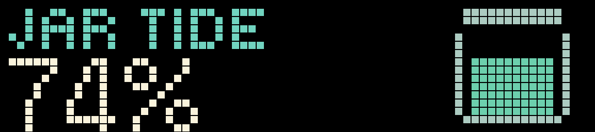
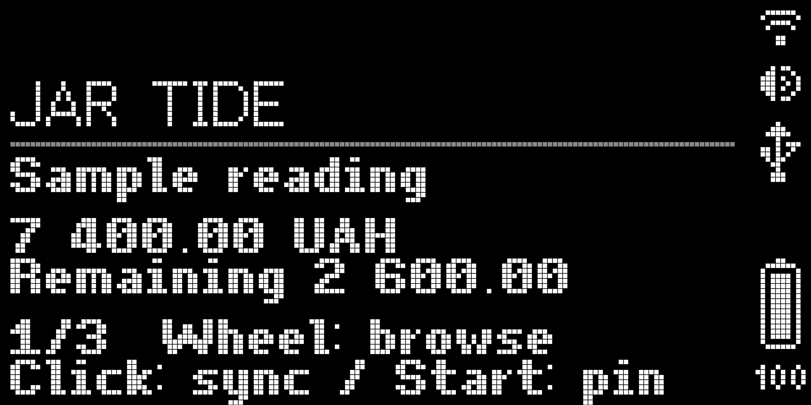

# Jar Tide

Follow one monobank jar, its remaining goal and the latest balance change.

One jar gets the whole display. You can see the next attainable amount at a glance without opening your bank account each time someone asks how a collection is going.

On the goal page the jar fills from the bottom as the balance approaches the target. The amount and change pages leave room for the full number.

## Screen transitions

Follow the balance into its next milestone. The amount stays below the changing caption.



<details>

<summary>Watch the rear display</summary>



</details>

## Check the balance behind the percentage

1. Select one jar in your local configuration. The companion needs that jar’s ID or sendId and your token on the host.
2. Read the percentage on **JAR TIDE**. In the clip, the sample jar is at 74%. Turn once to see the corresponding balance.
3. Read the currency on the rear. In the sample, 7,400.00 UAH against a 10,000.00 UAH goal gives the percentage shown.


## Work out the next milestone

1. Turn back to **JAR TIDE** to leave the percentage showing, as in the clip.
2. To check the next quarter of the goal, browse beyond **LAST CHANGE** to **NEXT MILESTONE**. Look at the rear for the exact amount still needed.
3. Press **Start** to keep the chosen page in place. The companion limits upstream reads to one per 65 seconds.


## Example from the emulator

At 7,400.00 UAH, the 75% milestone is 7,500.00 UAH, so the shortfall is 100.00 UAH. The GIF shows the balance and percentage pages. With a missing goal, the companion still reports balance and uses **No goal** for progress. The recorded example used a simulated monobank response.

## Set up the source

Set MONO_TOKEN in the environment of the companion and set jar in config.json to the specific jar ID or sendId. Tokens stay on your computer. The selected balance is returned in major currency units, including cents. Turn to the milestone page to see the exact amount needed for the next quarter of your goal. It marks completion at 100%. A missing or zero target is shown as no goal. The personal client-info endpoint is read at most once per 65 seconds. See https://api.monobank.ua/docs/.

## Connect the bar

Copy companion/example.json to a private config.json and adjust it for your source. From the project folder run `python3 companion/serve.py --config config.json`. Use Python 3.10+. Set Local companion URL to `http://127.0.0.1:8770/reading` on the emulator and allow local port 8770. On hardware, bind the companion to a trusted LAN interface and set its reachable address. The wheel browses pages. Click refreshes. Start pins or unpins the current page. The last good reading is labeled offline after a source error.

## Run in the emulator

Open BUSY Bar Emulator. From this repository, run:

```sh
~/.busy-emulator/bin/busy-emulator dev --once
```

Press **Back** to exit.

The GIFs are excerpts from the emulator recording. Each LED occupies a 16 × 16 cell with a black border. The end frames pause for reading.

[Full recording](media/controls.mp4) · [Rear display](screenshots/back-1.png) · [Firmware test](EMULATOR-QA.md) · [MIT license](LICENSE)
